[01 stack](#stack) ︱ [02 projects](#projects) ︱ [03 experience](#experience) ︱ [04 pipeline](#pipeline) ︱ [05 signal](#signal) ︱ [06 contact](#contact)

<!-- add a card per repo: copy a line and change repo= -->

